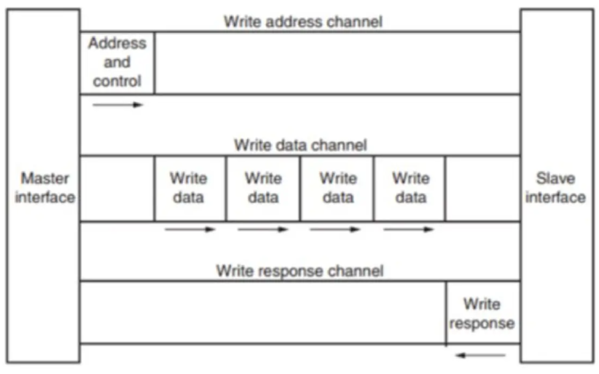
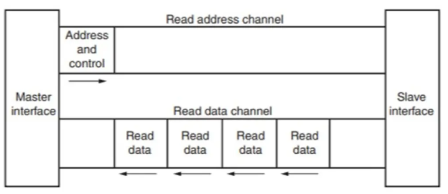
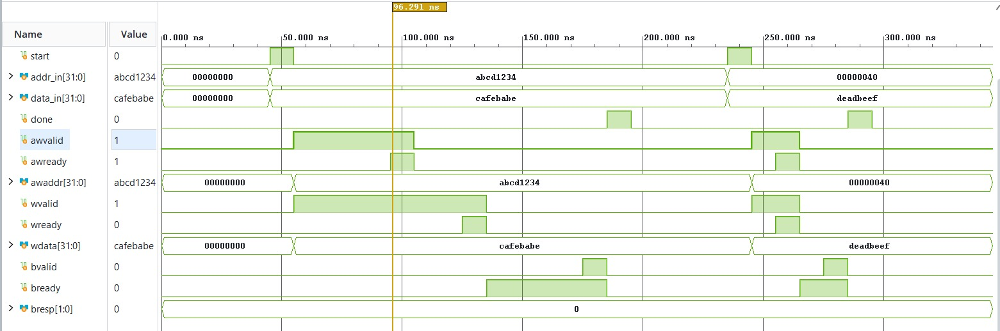
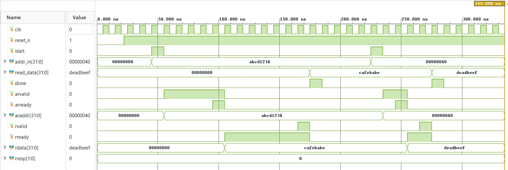

# AXI4-Lite Write and Read Master

A small project where I built an AXI4-Lite master (both write and read) in SystemVerilog and simulated it in Vivado. The main goal was to *see* the VALID/READY handshake in the waveform, so the testbenches are written to make that as clear as possible.

## About the project

AXI4-Lite is the simple, stripped-down version of the AXI protocol. It is mostly used to read and write registers in peripherals. I wanted to understand how the handshake between a master and a slave actually works, so I wrote a master for both directions and a slave model to test it against.

The one rule everything depends on:

> A transfer happens only on the clock edge where **VALID** and **READY** are both high.

The sender raises VALID along with its data and has to keep both steady until it sees READY. The receiver is free to raise READY before, after, or at the same time as VALID.

## What's in here

```
src/
    axi_lite_write_master.sv
    axi_lite_read_master.sv
tb/
    tb_axi_lite_write_master.sv
    tb_axi_lite_read_master.sv
docs/
    report
    images
README.md
```

## How a write works

A write uses three channels:

1. **Write address (AW):** the master sends the address using `awvalid` / `awready`
2. **Write data (W):** the master sends the data using `wvalid` / `wready`
3. **Write response (B):** the slave replies using `bvalid` / `bready`, with `bresp` telling us if it worked

The slave only sends the response after it has received both the address and the data.



In my master, the address and data channels run independently. Both VALID signals go high together, and each one drops as soon as its own READY arrives. Once both are finished, the master raises `bready` and waits for the response.

## How a read works

A read uses two channels:

1. **Read address (AR):** the master sends the address using `arvalid` / `arready`
2. **Read data (R):** the slave sends back the data using `rvalid` / `rready`, along with `rresp`

The slave only sends data after it has accepted the address.



## The design

Both masters are small state machines.

**Write master**

- `IDLE` waits for `start`, saves the address and data, and raises `awvalid` and `wvalid`
- `WRITE` holds each VALID until its READY shows up, then raises `bready`
- `RESP` waits for `bvalid`, then pulses `done` (and sets `error` if the response wasn't OKAY)

**Read master**

- `IDLE` waits for `start`, saves the address, and raises `arvalid`
- `ADDR` holds `arvalid` until `arready`, then raises `rready`
- `DATA` waits for `rvalid`, grabs the data, then pulses `done` (and sets `error` if the response wasn't OKAY)

The user-side signals are the same for both:

- `start` - one-cycle pulse to kick off a transaction
- `addr_in` - the address to access
- `data_in` - the data to write (write master only)
- `data_out` - the data that came back (read master only)
- `done` - one-cycle pulse when the transaction finishes
- `error` - goes high if the slave answered with something other than OKAY

Address and data are both 32 bits wide.

## Testbenches

Each testbench has a simple slave model and runs two transactions:

1. **Slow slave:** READY and the response arrive a few cycles late, so you can clearly see VALID sitting high and waiting.
2. **Fast slave:** everything responds right away.

The test values are:

- Address `0xABCD1234`, data `0xCAFEBABE`
- Address `0x00000040`, data `0xDEADBEEF`

The read slave returns those same values for those addresses, so you can write something and then read it back. Each testbench checks the result on its own and prints PASS or FAIL in the console.

I kept the slave's internal counters in a separate module so they don't clutter the waveform. Only the main AXI signals show up at the top.

## Running the simulation

I used Vivado for this. Here's how to run it:

1. Make a new project and add everything in `src/` as design sources and everything in `tb/` as simulation sources.
2. In the Sources window, open **Simulation Sources > sim_1**.
3. Right-click the testbench you want to run and pick **Set as Top**. Use `tb_axi_lite_write_master` for the write test or `tb_axi_lite_read_master` for the read test.
4. Go to **Run Simulation > Run Behavioral Simulation**.
5. In the waveform window, click **Zoom Fit**. Right-click the address and data signals and set the radix to **Hexadecimal**.

To switch between write and read, close the simulation, set the other testbench as top, and run it again.

If some signals show up blank in the waveform, turn on **Settings > Simulation > xsim.simulate.log_all_signals**, or type `restart`, then `log_wave -recursive *`, then `run all` in the Tcl console.

## Results

### Write transaction



You can see `awvalid` and `wvalid` staying high until `awready` and `wready` pulse. After both are done, `bready` goes high and the slave answers with `bvalid`. The first transaction uses the slow slave, and the second shows the fast one.

### Read transaction



`arvalid` stays high until `arready`. After that, `rready` waits for `rvalid`, and the value shows up on `rdata` and `read_data`. Again, the first transaction is slow and the second is fast.

## Things I'd like to add

- Back-to-back transactions
- Error responses (SLVERR / DECERR) to test the `error` flag
- A slave with real memory behind it
- Write strobes for partial writes
- A combined read/write master

## Tools

- Vivado (XSim)
- SystemVerilog

## Author

Vidya S R
GitHub: IvyRads

## License

MIT
